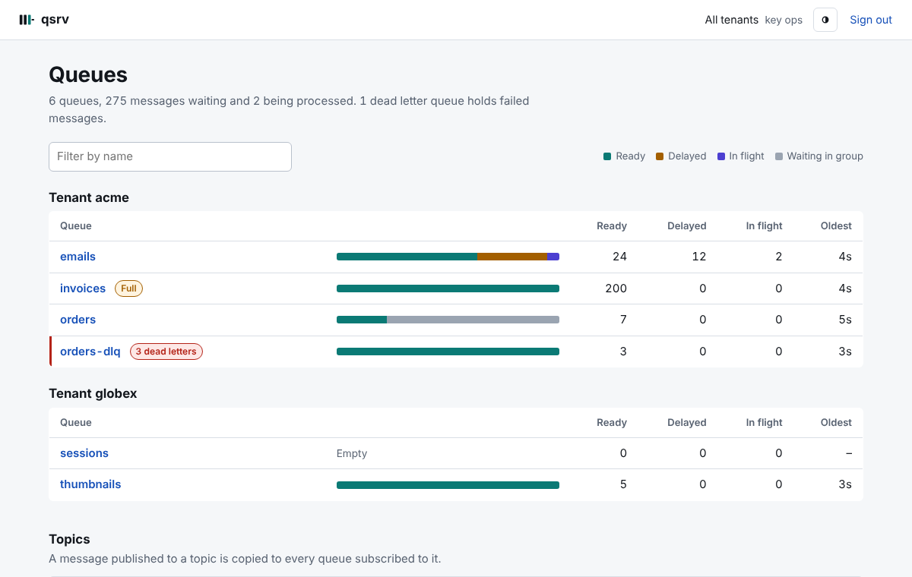

# qsrv

A durable message queue server you run as a single binary backed by SQLite.
Named FIFO queues over HTTP, with:

- **leases** with ack / nack / extend, and long polling;
- **retries** with exponential backoff and **dead-letter queues**;
- **ordering groups**: strict order per entity, parallel across entities;
- **delayed messages**;
- **topics**: publish once, every subscribed queue gets a copy, atomically;
- **history and replay** of processed messages;
- **multitenancy**: each API key belongs to a tenant and only sees its queues;
- **admin UI** at `/admin/`: queues, topics and messages at a glance, read-only;
- every acknowledged write is **fsynced**: a crash never loses what a client saw.

Clients for **Go** and **PHP**, a **Symfony Messenger** transport, a CLI,
Prometheus metrics and alerts. Static binaries: pure Go by default (SQLite
runs as WASM, cross-compiles anywhere); the Docker image uses native SQLite
through cgo for less CPU.

## Quickstart

```sh
git clone https://github.com/romycode/qsrv && cd qsrv
make setup   # asks how to run it (binary, Docker, or with Prometheus + Grafana),
             # ports, storage, backups and tenants, and generates the API keys
make up      # starts it; make status, make logs, make keys, make down
```

`make help` lists the rest (`add-key`, `restart`, `build`, `test`, ...).
The answers live in `.qsrv/` (git-ignored); run `make setup` again to change
them.

By hand instead:

```sh
git clone https://github.com/romycode/qsrv && cd qsrv
CGO_ENABLED=0 go build -o bin/ ./cmd/...                 # qsrv, qctl, qbench (Go 1.27+)
export PATH=$PWD/bin:$PATH

export QSRV_API_KEY=$(openssl rand -hex 32)              # the client's key
export QSRV_API_KEYS="acme:cli:$QSRV_API_KEY"            # server: tenant:name:key, comma-separated
qsrv -data-dir ./data -addr :8080 &

export QSRV_ADDR=http://localhost:8080
qctl create -max-attempts 5 -backoff 1s orders
echo '{"order_id": 1}' | qctl send -group customer-42 orders
qctl recv -wait 20s orders                               # prints the message and its lease
qctl ack orders <lease>
```

Or download `qsrv` and `qctl` for Linux or macOS from the
[releases](https://github.com/romycode/qsrv/releases).

With Docker:

```sh
docker run -d -p 8080:8080 -e QSRV_API_KEYS="$QSRV_API_KEYS" -v qsrv-data:/data ghcr.io/romycode/qsrv:latest
```

Or over plain HTTP:

```sh
H="Authorization: Bearer $QSRV_API_KEY"
curl -sH "$H" -X PUT  localhost:8080/v1/queues/emails -d '{}'
curl -sH "$H" -X POST localhost:8080/v1/queues/emails/messages -d '{"body":"hello"}'
curl -sH "$H" -X POST 'localhost:8080/v1/queues/emails/receive?wait=20s'
```

## Clients

### Go

```go
import "github.com/romycode/qsrv/pkg/client"

c := client.New("http://localhost:8080", os.Getenv("QSRV_API_KEY"))
c.SendWith(ctx, "orders", body, client.SendOptions{GroupID: "customer-42"})

for {
    d, err := c.Receive(ctx, "orders", 20*time.Second) // nil, nil when nothing arrived
    if err != nil || d == nil {
        continue
    }
    if err := handle(d.Message.Bytes()); err != nil {
        c.Nack(ctx, "orders", d.LeaseID) // retried with backoff, then the DLQ
        continue
    }
    c.Ack(ctx, "orders", d.LeaseID)
}
```

Fan-out: `c.CreateTopic(ctx, "orders", "billing", "email")`, then
`c.Publish(ctx, "orders", body, client.SendOptions{})` writes one copy to each
queue in a single transaction.

Runnable example with groups, a delayed message, retries, a DLQ and lease
heartbeats: [examples/go](examples/go/main.go).

### PHP and Symfony Messenger

```sh
composer require romycode/qsrv-php
```

```php
$qsrv = new Romycode\Qsrv\Client('http://localhost:8080', $_ENV['QSRV_API_KEY']);
$qsrv->send('orders', json_encode($event), groupId: 'customer-42');
if ($d = $qsrv->receive('orders', wait: 20)) {
    handle($d->message->body);
    $qsrv->ack('orders', $d->leaseId);
}
```

```yaml
# Symfony: config/packages/messenger.yaml
framework:
    messenger:
        transports:
            async: 'qsrv://%env(QSRV_API_KEY)%@qsrv.internal:8080/app-async'
            # qsrv retries by default (queue_config.retry + DLQ, keeps group order);
            # options: {native_retries: false} to use retry_strategy / failure_transport
```

Docs: [php/README.md](php/README.md). Runnable examples:
[examples/php](examples/php) (plain client, and Messenger with a Worker).

### CLI

```sh
qctl queues | info NAME | create [flags] NAME | delete NAME
qctl send [-group G] [-delay D] QUEUE [BODY|-]
qctl recv [-wait D] [-ack] [-raw] QUEUE         # exit 3 if empty
qctl ack|nack QUEUE LEASE   ·   qctl extend [-by D] QUEUE LEASE
qctl consume -concurrency 8 QUEUE -- ./handler.sh   # stdin = body; exit 0 = ack, else nack
qctl replay -to DEST [-from T] [-until T] [-group G] [-states S] QUEUE
qctl topic create NAME [QUEUE...] | sub|unsub NAME QUEUE | publish [-group G] NAME [BODY|-]
```

`consume` heartbeats the lease while the command runs, exports
`QSRV_MESSAGE_ID`, `QSRV_GROUP_ID` and `QSRV_ATTEMPTS`, and on SIGINT lets
running jobs finish. `qctl <command> -h` lists each command's flags.

### Admin UI

Open `http://localhost:8080/admin/` and sign in with an API key: every
queue of the key's tenant (or of every tenant, with an admin key), what is
waiting and for how long, dead letters, and each message's body. Read-only.
[More](docs/operations.md#admin-ui).



## Documentation

| | |
|---|---|
| [Concepts](docs/concepts.md) | leases, retries and DLQs, ordering groups, delays, topics, replay, guarantees |
| [HTTP API](docs/api.md) | every endpoint, request and response, error codes |
| [Production](docs/production.md) | checklist before going live: promises, storage, backups, security, monitoring, sizing |
| [Operations](docs/operations.md) | configuration, API keys and tenants, Docker, backups, metrics, alerts and Grafana dashboards, sizing |
| [PHP](php/README.md) | client, Messenger transport, retries with Messenger vs qsrv |
| [Development](docs/development.md) | tests, benchmarks, CI, commits, releases, internals |
| [CI](docs/ci.md) | what each GitHub Action does, releases, troubleshooting |
