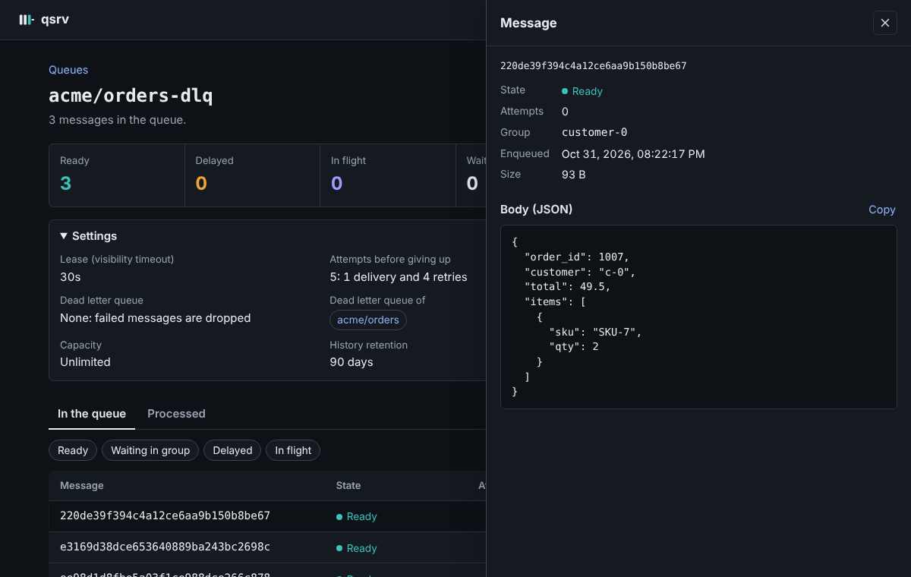

# Operations

Running qsrv in production: configuration, Docker, backups, monitoring and
sizing.

## Run

The quickest way: `make setup` asks everything below (how to run qsrv,
address, TLS, metrics, admin UI, data and snapshot directories, free-disk
threshold, tenants) and generates the API keys into `.qsrv/`; `make up`
starts it in the chosen mode: the binary in the background, one Docker
container, or `deploy/monitoring` with Prometheus and Grafana. `make status`,
`make logs`, `make down`; `make add-key TENANT=acme NAME=billing` adds a key
and reloads the keys of the running qsrv, no restart. The rest of this page is
what those choices do.

Requires Go 1.27+. Pure Go by default: SQLite runs as WASM inside the wazero runtime
(`ncruces/go-sqlite3`), so builds are static and cross-compile anywhere.
The first start compiles SQLite to native code (~1-1.5s) and caches it in
`data-dir/.wasmcache`; later starts take ~50ms.

```sh
CGO_ENABLED=0 GOOS=linux GOARCH=arm64 go build -trimpath -ldflags='-s -w' -o bin/ ./cmd/...   # e.g. Graviton
```

cgo driver (`mattn/go-sqlite3`, native SQLite), same behavior and file
format, used by the Docker image. Measured: ~1.7-1.9x less CPU per operation
in the storage layer; over HTTP ~20% more max throughput on a fast local disk,
~10% with 1ms commits, same latency at normal load, ~15MB less RSS, starts in
~250ms with no compile cache. Static binary (needs a C compiler; musl or glibc):

```sh
CGO_ENABLED=1 go build -tags sqlite_cgo,sqlite_omit_load_extension,netgo,osusergo -trimpath \
  -ldflags '-s -w -linkmode external -extldflags "-static"' -o bin/qsrv ./cmd/qsrv
```

`qsrv -version` prints the driver. Both drivers read and write the same files:
switching is a redeploy, no migration.

```sh
CGO_ENABLED=0 go build -o bin/ ./cmd/...
export QSRV_API_KEYS="acme:billing:$(openssl rand -hex 32)"   # tenant:name:key, comma-separated
./bin/qsrv -data-dir /var/lib/qsrv -addr :8080    # or -api-keys-file keys.txt
```

| Flag / env | Default | |
|---|---|---|
| `-addr` / `QSRV_ADDR` | `:8080` | |
| `-data-dir` / `QSRV_DATA_DIR` | `./data` | holds `qsrv.db` (every tenant) and the WASM compile cache; flock'd, one process per dir |
| `-api-keys-file` / `QSRV_API_KEYS_FILE`, `QSRV_API_KEYS` | — | `tenant:name:key` entries; required unless `-insecure-no-auth`. See [API keys and tenants](#api-keys-and-tenants) |
| `-tls-cert`, `-tls-key` | — | serve HTTPS directly; otherwise put TLS in front |
| `-max-message-bytes` | 256KiB | |
| `-retention-check` | 1m | janitor interval |
| `-backup-dir` / `QSRV_BACKUP_DIR` | — | snapshots of every tenant here; see [Backups](#backups) |
| `-backup-every` / `QSRV_BACKUP_EVERY` | 1h | snapshot interval |
| `-backup-keep` / `QSRV_BACKUP_KEEP` | 24 | snapshots kept |
| `-admin` / `QSRV_ADMIN` | `true` | read-only admin UI at `/admin/` on the API address; `false` turns it off. See [Admin UI](#admin-ui) |
| `-min-free-disk` / `QSRV_MIN_FREE_DISK` | 1GiB | below this free space, refuse new data with `503 storage_full`. See [Disk full](#disk-full); `0` disables |
| `-metrics-addr` / `QSRV_METRICS_ADDR` | `127.0.0.1:9464` | Prometheus `/metrics`, no auth; empty disables |
| `-log-level` / `QSRV_LOG_LEVEL` | info | JSON logs to stderr |

Signals: SIGTERM shuts down (long-polls get 503 immediately, pending writes
commit, exit 0); SIGHUP reloads the API keys.

## API keys and tenants

qsrv is multitenant. Every API key belongs to a **tenant**, and a key only
sees its tenant's queues and topics. Entries are `tenant:name:key`:

```text
# /etc/qsrv/keys  (-api-keys-file; QSRV_API_KEYS takes the same entries, comma separated)
acme:billing:9f2c...            # tenant acme, key "billing"
acme:emails:41ab...             # another key of acme: same queues
globex:app:7d0e...              # tenant globex
*:ops:c3a1...                   # admin: every tenant
```

| part | rules |
|---|---|
| tenant | `[a-z0-9][a-z0-9_-]{0,39}`, or `*` for an admin key |
| name | `[A-Za-z0-9_.-]{1,40}`: shows up in the access logs, not secret |
| key | the secret the client sends (`Authorization: Bearer <key>`), 32+ chars: `openssl rand -hex 32` |

**Tenant keys** work inside their tenant and don't change anything for
clients: they create and use `orders`, which qsrv stores as `acme/orders`.
Every name in a request resolves in the key's tenant, in paths and in bodies
(`dead_letter_queue`, a topic's queues, a replay's `to`). Another tenant's
queues, topics and leases look exactly like ones that don't exist (`404`), and
two tenants can have queues with the same name.

**Admin keys** (`*`) see every tenant and use full names: `GET /v1/queues`
returns `acme/orders`, and `qctl info acme/orders` works. A queue or topic
always belongs to a tenant, so an admin creating one must name it
`tenant/name`. Even admins can't make references across tenants (a DLQ, a
subscription or a replay into another tenant). `-insecure-no-auth` makes
every request an admin.

There is no tenant to create: a tenant exists as soon as a key names it, and
its queues appear when it creates them. Isolation is of names and data,
not of resources: all tenants share one SQLite database, so concurrent
commits of every tenant share one transaction and one fsync. That is
deliberate: one database per tenant was measured (100 tenants, 10KB
messages) at ~1.6x the latency, twice the CPU and four times the memory,
because each commit then carries one message and pays its own fsync.

There are no per-tenant quotas. A tenant that needs hard isolation (its own
SLA, a heavy load, compliance) gets a **dedicated qsrv** on its own disk or
machine, configured with only that tenant's keys; its clients just use that
URL. Normal tenants stay on the shared instance.

**Rotation without restarts**: edit the keys file (or `QSRV_API_KEYS`) and
send `SIGHUP` (`kill -HUP <pid>`, `docker kill -s HUP qsrv`). The new set
applies to the next request; a file that doesn't parse is rejected and the
current keys stay (logged as an error). To rotate a key: add the new entry,
reload, move the clients, remove the old entry, reload.

**Access logs** carry `tenant` and `key` (the name). Metrics label queues
with their full name (`queue="acme/orders"`).

## Admin UI

`http://<qsrv>/admin/`: a read-only web panel, served by qsrv itself on the
API address (no extra service, nothing to install).


- **Queues**: per queue, what is ready, delayed, in flight and waiting
  behind its ordering group, with the age of the oldest message (amber after
  5 minutes, red after an hour). Dead letter queues holding messages are
  marked. Topics and their subscribers. Refreshes every 3 seconds.
- **A queue**: its counts and settings (lease, retries, DLQ, ordering,
  capacity, retention), the messages in it and the processed ones (acked,
  dropped, dead-lettered, while retention keeps them), filterable by state.
  Click a message to see its body (JSON is indented) and metadata.
- It never changes anything: no sends, acks, deletes or replays. Looking at
  a message doesn't receive it.



**Sign in with an API key.** An admin key (`*`) sees every tenant; a tenant
key, only its tenant. The key is exchanged for a session cookie
(`HttpOnly`, `SameSite=Strict`, `Secure` over HTTPS or behind a proxy that
sets `X-Forwarded-Proto: https`) that lasts 12 hours. The server keeps only
the key's hash and checks it on every request: remove a key and reload
(SIGHUP) and its sessions end at once. Sessions live in memory, so a restart
signs everyone out. With `-insecure-no-auth` there is no sign-in and anyone
reaching the port sees everything.

The panel is on the same port as the API, so whoever can reach the API can
reach the sign-in page. To keep it off a public address, run qsrv with
`-admin=false` there, or let your proxy route `/admin/` only from your
network. It sends a strict Content-Security-Policy and refuses to be framed;
Alpine.js (embedded, no CDN) needs `'unsafe-eval'` in it.

## Disk full

A commit that fails (no space left) makes qsrv exit, because memory would
be ahead of disk; restarting into a full disk would fail the same way. To
never get there, below `-min-free-disk` (default 1GiB) qsrv refuses what
adds data, with `503 storage_full` and `Retry-After: 30`: sends, publishes,
replays and creating queues or topics. Receive, ack, nack, extend, deletes
and the retention purge keep working, so consumers drain the backlog. Writes
are accepted again within 2 seconds of the space coming back.

`qsrv_storage_low` is 1 while it lasts, and the `QsrvStorageFull` alert
fires. Size the threshold above what a few minutes of traffic writes, and
keep snapshots on another disk (see [Backups](#backups)).

## Docker

Multi-arch image (`linux/amd64`, `linux/arm64`) on GitHub Container Registry,
built from the `Dockerfile`: `qsrv` with the cgo driver, linked statically
against musl, on `distroless/static`, non-root, no shell. It contains `qsrv`
and `qctl`.

| tag | |
|---|---|
| `latest`, `X`, `X.Y`, `X.Y.Z` | releases (`vX.Y.Z` tags; `X` only from 1.0) |
| `edge`, `sha-<commit>` | every push to `main` |

```sh
docker run -d --name qsrv -p 8080:8080 \
  -e QSRV_API_KEYS="acme:app:$(openssl rand -hex 32)" \
  -v qsrv-data:/data \
  ghcr.io/romycode/qsrv:latest
```

- **Data**: `/data` (volume). It holds `qsrv.db` and the compiled-SQLite cache;
  one container per volume.
- **Config**: same flags as the binary (`docker run ... ghcr.io/romycode/qsrv -retention-check 5m`)
  or env vars. The image sets `QSRV_ADDR=:8080`, `QSRV_DATA_DIR=/data` and
  `QSRV_METRICS_ADDR=:9464` (metrics have no auth: don't publish 9464
  beyond your network). Prefer `QSRV_API_KEYS_FILE` with a mounted secret
  over keys in the environment.
- **Health**: built-in `HEALTHCHECK` (`qsrv -healthcheck`, which probes
  `/healthz`). For Kubernetes use `httpGet /healthz` on 8080.
- **Shutdown**: SIGTERM commits pending writes; give it a grace period
  (`docker stop -t 30`, `stop_grace_period`).
- **CLI inside**: `docker exec -e QSRV_ADDR=http://127.0.0.1:8080 -e QSRV_API_KEY=... qsrv qctl queues`.

Compose file with a volume and private metrics: [deploy/docker-compose.yml](../deploy/docker-compose.yml).

## Backups

The single-node weak point is the disk. qsrv takes snapshots itself:

```sh
qsrv -data-dir /var/lib/qsrv -backup-dir /mnt/backup/qsrv -backup-every 1h -backup-keep 48
```

- Every `-backup-every`, the database is copied with SQLite's `VACUUM INTO`:
  a consistent, compacted copy of every tenant, live messages and history,
  taken from one read transaction without blocking writes.
- A snapshot is `backup-dir/<UTC time>/qsrv.db` plus a `manifest.json`
  (tenants, size, schema version). It is written under a `.tmp-` name,
  fsynced and renamed when complete: a directory with a timestamp name is
  always whole. The newest `-backup-keep` are kept.
- **Put `-backup-dir` on another disk** (a second volume, NFS, a mounted
  bucket), or ship it off the machine (`rclone sync`, `aws s3 sync` from
  cron, which can ignore `.tmp-*`). A snapshot on the same disk does not
  survive losing that disk.
- `qsrv_backup_last_success_timestamp_seconds`, `qsrv_backup_failures` and
  the `QsrvBackupStale` alert tell you when they stop.

What a snapshot can lose: everything after it. With `-backup-every 1h`, up
to an hour of messages. Messages delivered or acked after the snapshot come
back as they were at that moment, so consumers see some again (at-least-once,
as after any crash).

**Restore** (qsrv stopped):

```sh
# Whole server
mv /var/lib/qsrv /var/lib/qsrv.broken                         # keep it, just in case
mkdir /var/lib/qsrv && cp /mnt/backup/qsrv/20261031T180000Z/qsrv.db /var/lib/qsrv/

# One tenant: its queues, topics, live messages and history go back to the
# snapshot; every other tenant is untouched. One transaction.
qsrv -data-dir /var/lib/qsrv -restore-tenant acme -from /mnt/backup/qsrv/20261031T180000Z
```

Copy the snapshot: don't point `-data-dir` at the backup directory itself,
qsrv would write into it. A snapshot restores with the same qsrv schema
version that took it (in `manifest.json`).

For a smaller window than the snapshot interval,
[Litestream](https://litestream.io) can replicate `qsrv.db` continuously
(seconds of loss).

## Metrics and alerts

Prometheus text format on `-metrics-addr` (default `127.0.0.1:9464`, path
`/metrics`). No auth: keep it on localhost or a private interface.
Ready-to-use rules in `deploy/prometheus/alerts.yml` (thresholds marked `TUNE`).

| Metric | Type | What it tells you |
|---|---|---|
| `qsrv_queue_oldest_message_age_seconds{queue}` | gauge | **The** health signal: how long the oldest live message has waited |
| `qsrv_queue_messages{queue,state}` | gauge | ready / delayed / in_flight / waiting (behind its ordering group); they add up to the queue's messages |
| `qsrv_queue_groups{queue}` | gauge | ordering groups with live messages |
| `qsrv_messages_total{queue,event}` | counter | sent, dead_letter_in, replay_in, delivered, redelivered, acked, nacked, expired, dead_lettered, dropped |
| `qsrv_store_commit_duration_seconds` | histogram | commit + fsync latency (disk health; every op waits for it) |
| `qsrv_store_commit_batch_ops` | histogram | ops per commit (group commit efficiency) |
| `qsrv_store_pending_writes` | gauge | ops waiting for the disk |
| `qsrv_http_requests_total{route,method,code}` | counter | route = ServeMux pattern (bounded cardinality) |
| `qsrv_http_request_duration_seconds{route}` | histogram | receive includes long-poll wait |
| `qsrv_disk_free_bytes`, `qsrv_disk_size_bytes`, `qsrv_db_size_bytes{file}` | gauge | capacity planning, WAL growth |
| `qsrv_storage_low` | gauge | 1 while sends are refused for lack of disk |
| `qsrv_backup_last_success_timestamp_seconds`, `qsrv_backup_interval_seconds`, `qsrv_backup_failures`, `qsrv_backup_last_duration_seconds`, `qsrv_backup_last_size_bytes` | gauge | snapshots (only with `-backup-dir`) |
| `qsrv_queue_info`, `qsrv_queue_max_messages`, `qsrv_build_info`, `qsrv_start_time_seconds`, process/Go stats | gauge | context for alerts |

Alerts included: down, restart loop, 5xx ratio, messages too old (warning /
critical), queue without consumers, dead-lettered/dropped messages, DLQ not
empty, high redelivery ratio, lease expiries, queue near full, 429s, disk
low / critical / will fill in 3 days, slow commits, writer backlog, WAL
growth, memory. DLQs are excluded from the "too old" and "no consumers"
alerts via the `qsrv:dlq:is_dlq` recording rule.

Validate before deploying: `promtool check rules deploy/prometheus/alerts.yml`.

### Grafana dashboards

Three dashboards in `deploy/grafana/dashboards/`, linked to each other, with
the alerts that fired drawn as annotations on every graph:

| dashboard | for |
|---|---|
| **qsrv / Overview** | Is it healthy? Up, version, alerts firing, messages waiting, oldest message, disk. Oldest message age per queue, messages by queue and by state (ready, waiting in group, delayed, in flight), throughput, failures, dead letter queues, a table of every queue now (click one for its dashboard). Storage: commit latency, group commit, writes waiting for the disk, free space and where it is heading, database and WAL size. Snapshots. HTTP: requests, 429/5xx, p99 latency. Memory and goroutines. |
| **qsrv / Queue** | One queue: its counts, settings (DLQ, retries, ordering), capacity used, failures; over time its states, oldest message, throughput in and out, failures, redelivery ratio, ordering groups. |
| **qsrv / Alerts** | Alerts firing and pending now with their labels, which fired in the time range and when, and what each alert means and what to do. |

Variables: Prometheus data source, job, instance, tenant and queue (the
overview takes several; the queue dashboard one). They need Grafana 11 or
later and the `job="qsrv"` scrape job the alert rules expect; the
"oldest message" and DLQ panels use the `qsrv:dlq:is_dlq` recording rule
from `alerts.yml`.

**Import** them (Dashboards → New → Import, pick the Prometheus data
source), or **provision** them: `deploy/grafana/provisioning/` has the data
source and a provider that loads the folder.

**The whole stack** in one command, provisioned: qsrv, Prometheus with the
alert rules, Alertmanager (receivers to fill in) and Grafana with the
dashboards:

```sh
echo "QSRV_API_KEYS=acme:app:$(openssl rand -hex 32)" > deploy/monitoring/.env
docker compose -f deploy/monitoring/docker-compose.yml up -d
# Grafana http://localhost:3000 (admin / admin), Prometheus :9090, Alertmanager :9093
```

Alertmanager ships with commented Slack and email receivers, and with
inhibitions: `QsrvDown` silences the rest of that instance's alerts, and a
critical alert its own warning.

## Performance

Measure on your own hardware with `qbench` (included) against a running server:

```sh
qbench -producers 8 -consumers 16 -duration 30s -size 1024   # saturation
qbench -rate 50 -groups 20 -duration 60s                      # latency at steady load
```

Reference (HTTP end to end, 1KB bodies, 2 vCPU shared with the load
generator, local disk with ~260µs fdatasync; slower disks emulated with
`-debug-simulated-sync-latency`, which adds a fixed delay per commit, so real
tail latencies will be worse):

| extra commit latency | ≈ disk | max full cycles/s (send+recv+ack) | end2end p50 / p99 at 50 msg/s |
|---|---|---|---|
| 0 | local NVMe | ~1,800 | 4ms / 11ms |
| 250µs | io2 Block Express | ~1,400 | 9ms / 15ms |
| 1ms | gp3 (good case) | ~1,280 | 9ms / 15ms |
| 3ms | gp3 (bad case) | ~740 | 18ms / 25ms |

Server CPU ≈ 0.5ms per full message cycle (3 HTTP requests); RSS ~20-30MB.
Storage: ~body size + ~150 bytes per message; 50k/day of 1KB ≈ 60MB/day of
history, ~5.5GB at the default 90-day retention.

## Limits

- Single node: no replication or failover. Use Litestream (above) for
  disaster recovery with seconds of RPO.
- One process per data directory (it is locked).
- No per-key permissions: any valid key can do everything.
